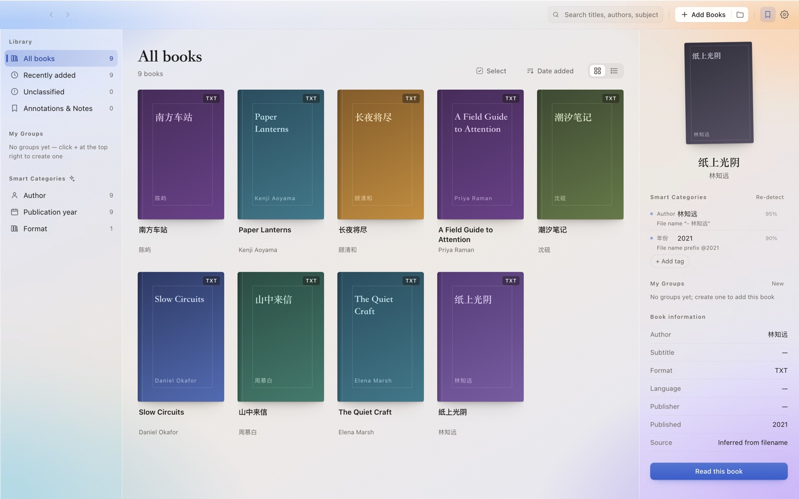
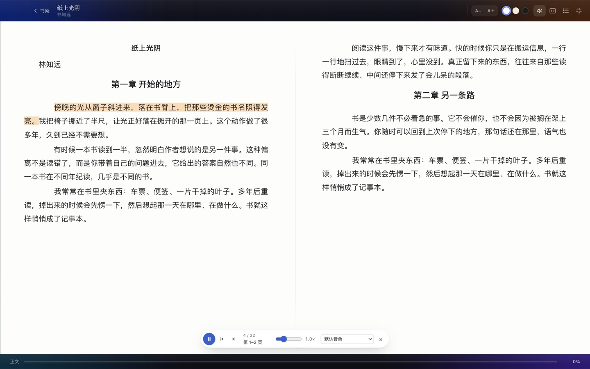
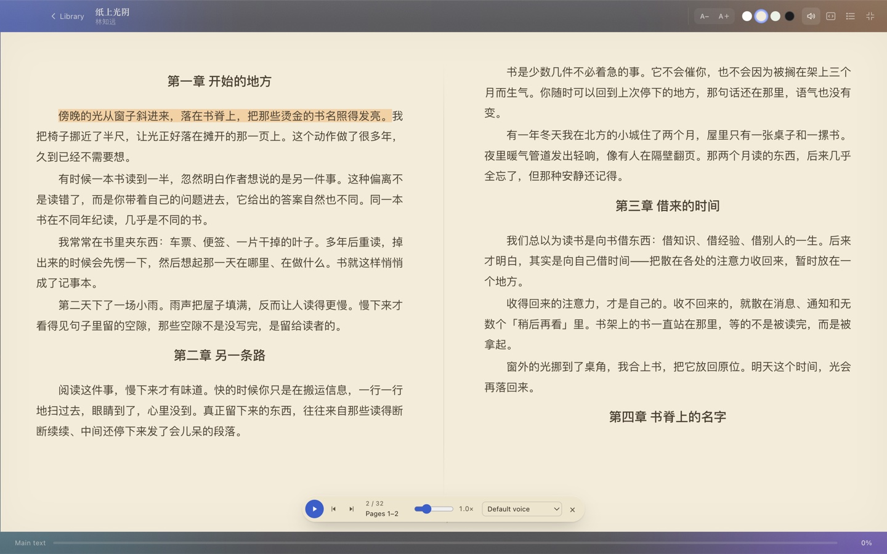
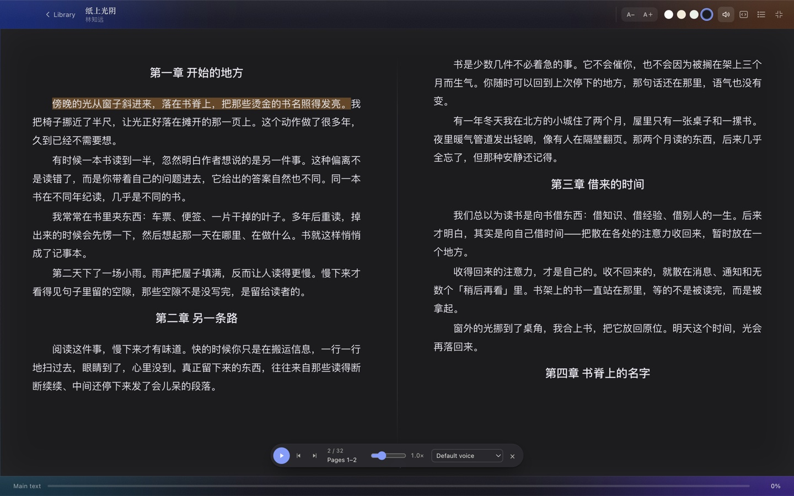

# Lumora

**A local-first ebook reader for macOS and Windows.**

Your books live on your own disk, your notes on your own machine. No sign-in, no network, no uploads. Open it and read; come back to the paragraph you left.

  
  
  
  

---

## Download

Pick the installer for your platform from [**Releases**](https://github.com/collinhlau/Lumora/releases):

| Platform | File | Notes |
|---|---|---|
| macOS (Apple Silicon) | `Lumora-0.3.1-arm64.dmg` | Drag into Applications |
| Windows 10 / 11 · 64-bit | `Lumora-0.3.1-x64-setup.exe` | Installer |
| Windows 10 / 11 · 32-bit | `Lumora-0.3.1-ia32-setup.exe` | For older machines |

> These are the only two platforms: macOS is Apple Silicon native (no Intel build), Windows is 10 / 11. Windows 7 / 8 is no longer supported.

> The builds are not code-signed. On macOS, right-click → **Open** the first time. On Windows, if SmartScreen warns you, click **More info** → **Run anyway**.

## Why another reader

Most reading software assumes you will sign up for an account and upload your library into its cloud. Lumora goes the other way: **it only reads files you already have, and only writes data of its own.**

- It never moves, renames, or copies your books. The shelf reads from wherever the files already sit.
- Library, reading position, annotations, and voice preferences all stay on this machine. There is no account system and no telemetry.
- Exactly two things can reach the network, and both point at addresses you supply: a translation endpoint and an update manifest. Leave them blank and it never goes online.

## What it does

### Reading

- **Four formats**: EPUB (precise CFI positioning), PDF (original layout preserved), MOBI / AZW3 (hand-written pure-JS parser, zero dependencies), TXT (custom pagination).
- **A position that survives**: close the app and reopen it, and you land on the same paragraph. Positions are stored as character offsets, so changing the font size, switching between single- and two-page layout, or resizing the window never drops you in the wrong place.
- **Four paper tones**: light, sepia, eye-care green, and dark. The whole interface shifts with the page, not just the text.
- **Two interface languages**: English and 简体中文, switchable in Settings. On first launch it follows your system language and remembers what you pick; the native menu and system dialogs switch with it.
- **Annotations**: select to highlight, attach a note, browse them grouped by chapter in the side panel, export to Markdown with backlinks.
- **Read aloud**: system voices, chapter-long playback, the current sentence highlighted as it is spoken, automatic page and chapter turns, adjustable rate and voice.

The current sentence is highlighted during playback, with controls at the bottom. Pages turn automatically.

**Paper tones**, with the interface following along:

| Sepia | Dark |
|---|---|
|  |  |

### Organizing

- **Library scan**: register a few folders and it finds books recursively, indexing incrementally by path + size + mtime so a second scan does no redundant work; folder changes sync automatically.
- **Automatic tagging**: virtual tags derived from author, language, era, subject, series, and format. Every tag carries its source and confidence — open it to see why a book landed there, and fix it when it is wrong.
- **Your files stay untouched**: all classification is virtual. Not a single byte of the original file moves.
- **Cover recovery**: when metadata carries no cover, it looks for an image on the opening pages of the text, then scores manifest filenames.

### Layout tools (macOS)

- **Screenshot to code**: replace screenshots of code inside a book with a selectable, scalable code block — indentation and blank lines rebuilt, light syntax highlighting, one click back to the original image.
- **Image fitting**: resize figures to the text column and body font size, so a single image no longer swallows a whole page.
- **Sharpening**: dependency-free canvas enhancement, or wire it to an external Real-ESRGAN.
- **Image-only EPUB to standard EPUB**: for books that are entirely scanned images, recognized and reflowed into selectable text.

These features rely on system OCR (macOS Vision) and are not available on Windows.

## Keyboard

| Action | Keys |
|---|---|
| Page turn | `←` `→` / `PageUp` `PageDown` |
| Table of contents | `T` |
| Zoom in / out / reset | `⌘/Ctrl +` `-` `0` |
| Immersive mode (hide all chrome) | `⌘/Ctrl + Shift + F` |
| Step back out (overlay, then immersive, then the book) | `Esc` |
| Select all in batch mode | `⌘/Ctrl + A` |

## Privacy

Nothing is uploaded. Shelf, reading progress, annotations, and voice preferences are stored locally, in the application's own data directory. There is no account, no analytics, and no crash reporting.

## License and compliance

- Released under the MIT license; see [`LICENSE`](LICENSE).
- Third-party components and their license texts: [`THIRD-PARTY-NOTICES.md`](THIRD-PARTY-NOTICES.md), also shipped inside the installer.
- **No DRM**: there is no DRM circumvention or decryption of any kind. Protected files are reported and parsing stops. Only import files you have the right to read.
- **No fonts bundled**: only system font names are referenced.

---

This repository hosts release builds and documentation only. The application source is not public.
